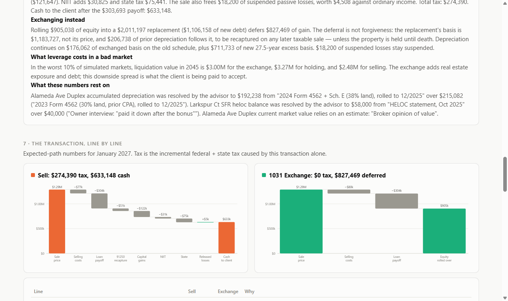

# Hold · Sell · Exchange

**A tax-exact simulation engine for the biggest decision on a real estate investor's balance sheet: hold the property, sell it, or 1031-exchange it.**

**Live demo:** https://doubleb219.github.io/hold-sell-exchange/ (open [`#demo`](https://doubleb219.github.io/hold-sell-exchange/#demo) to skip reconciliation)


An advisor sits down with a client whose rentals are a third of their net worth. The numbers on the screen when they say "hold", "sell", or "exchange" need to be right to the dollar, explainable line by line, and built only on facts somebody has stood behind. This project is my take on that problem as a simulation:

- It **simulates buying and selling real estate month by month** over a 10–30 year horizon: rents, vacancies, expenses, five loan types, depreciation, passive-loss carryforwards, a taxable brokerage account, and the transaction itself.
- It runs every strategy against **hundreds of simulated markets** (seeded, reproducible) and shows the full distribution, not one spreadsheet scenario.
- **The math is deterministic and tested to the dollar.** There's no model in the numbers. The plain-English advisor brief is a template over the ledger, so every sentence traces back to a line item.

## What it does

| Section | What you see | Why it matters |
|---|---|---|
| **1. Household from documents** | Four properties, every figure tagged with its source (tax return, closing statement, lender statement, owner, estimate) | The data doesn't exist in any one system |
| **2. Reconcile before you compute** | Conflicting observations of the same fact, e.g. two returns implying different depreciation (30% vs 38% land), or lender vs. owner on a HELOC balance. **The engine refuses to run until you pick a source.** It never averages. | "Nothing downstream runs on a number nobody has stood behind" |
| **3. Watchlist** | ARM reset in 3 months (+$3,843/yr), HELOC draw ending, interest-only cliff in 2032, a fourplex worth less than it cost, losses trapped by the §469 phase-out, four paid-off liens still on record | Monitoring: tell the advisor before the client calls |
| **4. The decision** | Pick the property, year, appreciation, volatility, replacement leverage/rate/yield, wages, state | |
| **5. Outcomes** | Fan chart (P10–P90 + median + expected path) for each strategy, under two endings: **sell everything** vs **pass to heirs with a §1014 step-up**, plus how often each strategy finishes richest | The right answer flips depending on how the story ends |
| **6. Advisor brief** | Deterministic narrative over the ledger | So the advisor can walk in alone |
| **7. Transaction ledger** | Waterfalls + a line-by-line sell vs. exchange table with the code section behind every line | Numbers the advisor can defend out loud |
| **8. Where the answer flips** | Heatmap of exchange − sell across appreciation × transaction year | Shows how sensitive the recommendation is to the market call |
| **9. Year by year** | Full annual ledger for each strategy | Audit trail |



## The tax engine (`src/engine/`)

Everything below is covered by tests in `tests/`:

- **Federal brackets**: exact for 2025 (post-OBBBA standard deduction), MFJ and single. Later years index by an assumed inflation rate and round to $25.
- **Capital gain stacking per the Schedule D Tax Worksheet**: ordinary income first, then **unrecaptured §1250 gain at min(bracket, 25%)**, then LTCG at 0/15/20%, with the result capped at the regular tax (worksheet line 47). Net capital losses absorb §1250 gain first, then up to $3,000 of ordinary income.
- **NIIT**: 3.8% on the lesser of NII or MAGI over the statutory (non-indexed) threshold.
- **MACRS 27.5-year straight line, mid-month convention**: matches the Pub. 946 Table A-6 percentages, with a half month in both the placement and disposition months. Capital improvements get their own schedules.
- **§469 passive activity losses**: the $25k allowance with its $100k–$150k phase-out, per-property suspended-loss tracking, release on a fully taxable disposition (§469(g)), and carryover through an exchange.
- **§1031**: amount realized, mortgage boot from net debt relief, recognized vs. deferred gain, replacement basis = price − deferred gain, depreciation history carried into future §1250 recapture, and **Reg. §1.168(i)-6** split depreciation: exchanged basis continues on the old schedule, and excess basis starts a new 27.5-year schedule.
- **§1231 losses** on sales below basis are ordinary.
- **Loans**: fixed, interest-only → amortizing, ARMs (periodic and lifetime caps, floor, ⅛% rounding), HELOCs (variable index + margin, draw → repay), and zero-balance liens that stay on record.
- **Tax impact of a transaction** = (tax with the transaction) − (tax without it), same household, same year. Components always foot to the dollar.

### The market model (`market.ts`)

- National appreciation follows a **monthly AR(1) with momentum**, scaled so the 12-month vol matches the input. Housing trends, and iid shocks understate multi-year drawdowns.
- Each property gets its own idiosyncratic shocks and an appreciation premium.
- Rents partially follow prices. The short rate is Vasicek and drives ARM and HELOC resets. The portfolio is lognormal with taxed dividends and realized gains on withdrawal.
- **Common random numbers**: hold, sell, and exchange all see the same market path, so the gaps between them come from the decision, not from sampling noise.
- **Seeded PRNG** (mulberry32): the same seed always gives the same result.

## Deliberate simplifications (and what I'd do next)

I'd rather list these than hide them:

1. **State tax is a flat marginal rate on AGI.** Federal is exact; real state brackets (and CA's treatment of gains as ordinary income) are next.
2. The **exchange closes in the same month** as the sale. It doesn't model the 45/180-day identification and closing windows, reverse exchanges, or DSTs.
3. **No AMT, no estate tax, no §121 exclusion** (for converted primary residences), and no installment sales.
4. Wages are assumed consumed. The portfolio is charged only for the tax that real estate and investments add *on top of* a wages-only return.
5. The heirs lens assumes a full §1014 step-up and ignores estate tax. With the exemption at $15M in 2026, that holds for most clients.

Next on my list: a document pipeline that produces `Observation`s straight from Schedule E, Form 4562, Form 8582, and lender statements, with per-field confidence and an eval set of real returns. The reconciliation layer is already built to take that input.

## Run it

```bash
npm install
npm test          # 31 tests: brackets, stacking, NIIT, MACRS tables, loans, 1031, §469, determinism
npm run dev       # http://localhost:5173/#demo
npm run build
```

Monte Carlo runs in a Web Worker: 300 paths × 3 strategies × 240 months in under 0.5 s.

## Layout

```
src/engine/       pure TypeScript, no UI dependencies
  tax.ts          federal brackets, Schedule D stacking, NIIT, §469 allowance
  depreciation.ts MACRS 27.5-yr mid-month tranches
  loans.ts        fixed / IO / ARM / HELOC / paid-off
  market.ts       seeded market paths
  reconcile.ts    multi-document fact reconciliation (never averages)
  simulate.ts     month-by-month engine, §1031, §469, year-end tax, ledgers
  montecarlo.ts   bands, win rates, breakeven grid
  watchlist.ts    monitoring alerts
  brief.ts        deterministic advisor narrative
src/ui/           SVG charts (no chart library)
tests/            vitest
```

*Fictional household. Not tax advice.*
